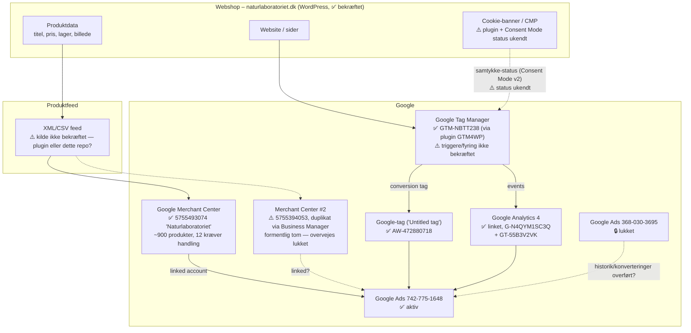

# Google Ads – struktur og dataflow

**Webshop:** [naturlaboratoriet.dk](https://naturlaboratoriet.dk)

Overblik over hvordan webshop, produktfeed, Google Merchant Center, Google Tag
Manager, cookie-samtykke og Google Ads hænger sammen.

## Konto-oversigt

| Konto | ID | Status |
|---|---|---|
| Google Ads | 742-775-1648 | Aktiv |
| Google Ads | 368-030-3695 | Lukket — tjek om noget (konverteringer, historik) skal overføres herfra |
| Google Merchant Center | 5755493074 ("Naturlaboratoriet") | Aktiv — 834 produkter (832 godkendt, 2 begrænset), 9 notifikationer, 2.21K klik/28 dage (-9,3%). Aktiveret 30. mar. 2026 |
| Google Merchant Center | 5755394053 ("Naturlaboratoriet") | ⚠️ Duplikat — aktiveret 21. aug. 2026, kun tilgængelig via "Virksomhedsadministrator" (dukker ikke op i den normale kontoskifter). Formentlig tom/ubrugt. **Lav prioritet — udskudt for nu** |

> Noter fra Merchant Center-screenshot: fanen **"Kræver handling"** under
> Produkter har ting der bør tjekkes (12 notifikationer) — det er typisk
> afviste produkter eller advarsler (manglende GTIN, forkert pris-format
> osv.), som betyder de produkter ikke vises i Shopping-annoncer før rettet.

## Hvor finder du det i Google Ads-fladen

Google Ads, Google Analytics og Google Merchant Center hænger sammen via
**"Linked accounts"** — men Google Tag Manager er et separat værktøj, ikke
noget du "linker" på samme måde:

1. **Merchant Center + Google Analytics (GA4):**
   Skruenøgle-ikon ("Tools and settings") øverst til højre → kolonnen
   **"Setup"** → **"Linked accounts"**. Her ses status og et "Details"-link
   for hver.
2. **Google Tag Manager:**
   Ligger på et helt andet site: **tagmanager.google.com** — ikke inde i
   Google Ads. Google Ads "ser" kun GTM indirekte, via
   konverteringsopsætningen: Skruenøgle → **"Measurement"** → **"Conversions"**.
   Der kan du se om en konverteringshandling er sat op med Google Tag direkte
   på sitet, eller via GTM.

> **Opdateret, bekræftet via "Dataadministration" i jeres konto:**
> - **Google Analytics (GA4):** ✅ linket (1 link)
> - **Google Merchant Center:** ✅ linket — men **2 link**, dvs. to
>   Merchant Center-konti er koblet til denne Google Ads-konto. Bør
>   undersøges hvorfor (fx en gammel/ubrugt konto ved siden af den aktive
>   5755493074).
> - **Google-tag:** findes ("Untitled tag" — ikke omdøbt), men det er endnu
>   ikke bekræftet om den fyrer via GTM eller er installeret direkte på
>   sitet. Tjekkes under "Administrer" på tagget.

> **Opdateret, bekræftet via Google Tag Manager:**
> - **GTM-container:** ✅ `GTM-NBTT238`, installeret på `www.naturlaboratoriet.dk`
> - **Google-tags i kontoen:**
>   - GA4: `G-N4QYM1SC3Q`
>   - Unified Google tag: `GT-55B3V2VK`
>   - Google Ads conversion (= "Untitled tag"): `AW-472880718`
> - ✅ Container kører som **live-version** (ingen preview/auth-miljø sat) —
>   bekræftet via GTM4WP-pluginnets indstillinger i wp-admin
> - ✅ GTM4WP har indbygget **WooCommerce-integration** (egen undermenu til
>   ecommerce-events)
> - ⚠️ Stadig ikke bekræftet: om tags rent faktisk **fyrer** (trigger-setup
>   inde i containeren), og om **Consent Mode v2** er konfigureret — pluginnet
>   har en dedikeret menu **"Consent mode & consent tools"**, som er næste
>   sted at tjekke

## Overblik (diagram)

> **Signaturforklaring:** ✅ bekræftet via screenshots · ⚠️ ikke bekræftet
> endnu · 🔒 lukket/inaktiv konto.

## Navigationsstier — hvor jeg fandt det

| Hvad | Sti |
|---|---|
| Google Ads-konti (aktiv + lukket) | Google Ads → profilbillede (øverst til højre) → kontoliste |
| Merchant Center produkter/tal (5755493074) | merchants.google.com → **Produkter** (venstre menu) → Alle produkter |
| Merchant Center-duplikat fundet (5755394053) | Google Ads → **Værktøjer** (skruenøgle, venstre sidebar) → **Dataadministration** → Google Merchant Center → "Administrer og tilknyt" → fane "Linket (2)" |
| Bekræftelse af duplikat via Business Manager | Google Ads → Merchant Center-række → "Foretag administration i Virksomhedsadministrator" → **Virksomhedsadministrator** → Apps og tjenester |
| GA4-link + Google-tag ("Untitled tag" / AW-472880718) | Google Ads → **Værktøjer** → **Dataadministration** |
| GTM container-ID (GTM-NBTT238) | tagmanager.google.com → fanen **Konti** |
| Google-tags (G-N4QYM1SC3Q, GT-55B3V2VK, AW-472880718) | tagmanager.google.com → fanen **Google-tags** |
| Platform WordPress + WooCommerce | wp-admin → venstre menu (WooCommerce synlig) |
| GTM4WP-plugin fundet | wp-admin → **Plugins** → Installed plugins → søg "GTM" |
| GTM-container bekræftet live + placering | wp-admin → Plugins → GTM4WP → **Settings** → "Google Tag Manager container" |
| *(mangler)* Consent Mode-status | wp-admin → Plugins → GTM4WP → Settings → **"Consent mode & consent tools"** |
| *(mangler)* Feed-plugin | wp-admin → **Plugins** → søg "feed" |

## Komponenterne

### 1. Webshop
Kilden til al data. Produktinfo (titel, beskrivelse, pris, lagerstatus,
billede, GTIN/EAN osv.) ligger her og skal holdes opdateret — det er det
Merchant Center senere henter.

### 2. Produktfeed
Et XML- eller CSV-dokument som webshoppen (eller et feed-værktøj) genererer
automatisk, i det format Google kræver. Opdateres typisk dagligt eller
hyppigere, så priser/lager altid er korrekte. Dette repo (`feeds-nl`) er
formentlig stedet feed-logikken/konfigurationen for det hollandske marked
ligger.

### 3. Google Merchant Center (GMC)
Henter produktfeed'en på et fast interval, **godkender eller afviser**
produkter (ud fra Googles regler — manglende GTIN, forkert pris-format,
billedkrav osv.), og stiller de godkendte produkter til rådighed for Google
Ads.

- **Linkes** til en Google Ads-konto (konto-til-konto link, ikke en tag).
- Fejl/advarsler på produkter tjekkes her — ikke i Google Ads.

### 4. Google Tag Manager (GTM)
Et "container"-script der lægges på hele websitet. I stedet for at indsætte
Google Ads/Analytics-kode direkte i sitet, styres alle tags (målinger,
remarketing, konverteringssporing) centralt fra GTM's interface.

Typiske tags i en webshop-opsætning:
- **Google Ads conversion tracking** — måler køb/leads der kommer fra annoncer
- **Google Ads remarketing tag** — bygger lister af besøgende til retargeting
- **GA4-konfiguration** — generel adfærdsmåling (sidevisninger, add-to-cart, køb)
- **Enhanced conversions** — sender hashed kundedata (email/telefon) med for
  bedre match-rate

### 5. Cookie-samtykke (CMP) + Consent Mode v2
Et cookie-banner (Cookiebot, OneTrust, CookieYes, Complianz, e.l.) spørger
besøgende om samtykke, **før** marketing-/statistik-cookies må sættes — et
krav under GDPR, og dermed relevant for et `.nl`-marked.

- CMP'en sender samtykke-status til GTM via **Google Consent Mode v2**
  (signalerne `ad_storage`, `ad_user_data`, `ad_personalization`,
  `analytics_storage`).
- GTM bruger de signaler til at afgøre **om** og **hvordan** tags fyrer:
  - Samtykke givet → fulde tags (cookies sættes, fuld sporing)
  - Samtykke afvist → Google kan stadig modtage **cookieless pings** (hvis
    Consent Mode er korrekt opsat), som bruges til modellering — men ingen
    cookies sættes, og ingen personlige data gemmes.
- **Uden korrekt Consent Mode-opsætning** mister Google Ads konverteringsdata
  fra besøgende der afviser cookies, hvilket forringer budoptimering
  (særligt i Performance Max, som er meget data-afhængig).

### 6. Google Ads
Her bygges kampagnerne:
- **Shopping / Performance Max**: bruger produkterne fra Merchant Center
  direkte — ingen separat annoncetekst/billede, Google sammensætter ud fra
  feed-data.
- **Search/Display/Video**: bruger konverteringsdata fra GTM-tagget til at
  optimere bud, og remarketing-lister til target.

## Dataflow, trin for trin

1. Produktdata opdateres i webshoppen.
2. Feed-filen regenereres (automatisk, scheduled).
3. Merchant Center henter feed'en, validerer og godkender produkter.
4. Godkendte produkter er tilgængelige for Google Ads via kontolinket.
5. Besøgende lander på sitet → cookie-banner viser sig → samtykke
   registreres.
6. GTM modtager samtykke-status → fyrer tags i overensstemmelse hermed.
7. Events (sidevisning, add-to-cart, køb) sendes til GA4 og Google Ads.
8. Google Ads bruger konverteringsdata + produktdata til at optimere bud og
   vise annoncer (Shopping/PMax) til relevante brugere.
9. Remarketing-lister (fra GTM-tagget) bruges til at vise annoncer til
   tidligere besøgende.

## Status og næste skridt (konkret for naturlaboratoriet.dk)

1. ✅ **Produktfeed** → Merchant Center — virker (834 produkter, 832 godkendt).
2. ✅ **Merchant Center linket til Google Ads** (742-775-1648).
3. ✅ **GTM-container installeret** (`GTM-NBTT238` via GTM4WP-plugin, live).
4. ✅ **Google-tags oprettet** (GA4, GT-unified, Google Ads `AW-472880718`).
5. ✅ **CMP/cookie-banner installeret** — **Complianz** sat op via guiden
   (GDPR/EU-region, Accepter/Afvis/Gem præferencer-knapper, cookie- og
   scriptblokering aktiveret, Google Fonts selv-hostes, ingen TCF-framework
   nødvendigt). Complianz fandt og aktiverede automatisk integration til
   **GTM4WP**.
6. 🔶 **Verificér Consent Mode v2 reelt virker**
   - ✅ Banneret vises korrekt live på sitet (Godkend/Afvis/Se præferencer +
     link til Cookiepolitik) — bekræftet via screenshot
   - ⬜ Stadig mangler: Tjek GTM4WP's **"Consent mode & consent tools"**-side
     i wp-admin for at se om Consent Mode-signalerne rent faktisk er slået
     til der
7. ⬜ **Bekræft at tags rent faktisk fyrer** — tjek triggers inde i
   GTM-containeren + brug Preview-mode, både med og uden samtykke givet.
8. ⬜ **Gennemgå de 10 eksisterende kampagner** (alle sat på pause pt.) —
   afklar om pausen er bevidst, og genaktivér/opdatér når tracking (trin 5-7)
   er på plads. Først herefter er det værd at overveje at bygge en helt ny
   kampagne.

> Rækkefølgen er vigtig: **cookie-banner og Consent Mode bør være på plads
> før kampagner genaktiveres** — ellers mangler Google Ads konverteringsdata
> fra besøgende der afviser cookies, hvilket giver dårligere budoptimering
> fra dag ét.

## Vigtige begreber

| Begreb | Betydning |
|---|---|
| **Feed** | Den fil Merchant Center henter produktdata fra |
| **Linked account** | Forbindelsen mellem Merchant Center og Google Ads (ikke en tag) |
| **Container (GTM)** | Samlingen af alle tags/triggers for ét website |
| **Consent Mode v2** | Googles standard for at signalere samtykke-status til Google-tags |
| **Enhanced conversions** | Ekstra matchdata (hashed email/telefon) for bedre konverteringssporing |
| **Performance Max (PMax)** | Kampagnetype der bruger produktfeed + AI til automatisk at vise annoncer på tværs af Googles flader |

## Åbne spørgsmål / ting at bekræfte

> Denne fil er lavet generisk, da jeg ikke kender jeres konkrete opsætning.
> Tjek/udfyld følgende for at gøre den præcis for jer. Skærmbilleder af
> GTM-containeret, cookie-bannerets indstillinger og Merchant Center er en
> hurtig måde at få dem udfyldt på.

- [x] **Platform:** ✅ **WordPress + WooCommerce** (bekræftet via wp-admin).
- [x] **GTM-installation:** ✅ sat op via pluginnet **"GTM4WP – A Google Tag
      Manager (GTM) plugin for WordPress"** (Thomas Geiger, v2.0.6), som
      lægger containeret `GTM-NBTT238` ind på sitet.
- [ ] Genereres feed'en af en WooCommerce-plugin (fx "Product Feed Pro",
      "WooCommerce Google Feed Manager" e.l.), eller af et separat
      feed-værktøj (fx dette repo)? — *søges efter i wp-admin ("feed")*
- [ ] Hvilken CMP/cookie-plugin bruges (for WooCommerce typisk Complianz,
      CookieYes, Cookiebot, eller Borlabs)?
- [ ] Er Consent Mode v2 allerede sat op i GTM, eller mangler det?
- [ ] Bruges Enhanced Conversions / server-side tagging?
- [ ] Hvor mange Merchant Center/Google Ads-konti er der (fx ét per land/marked)?
