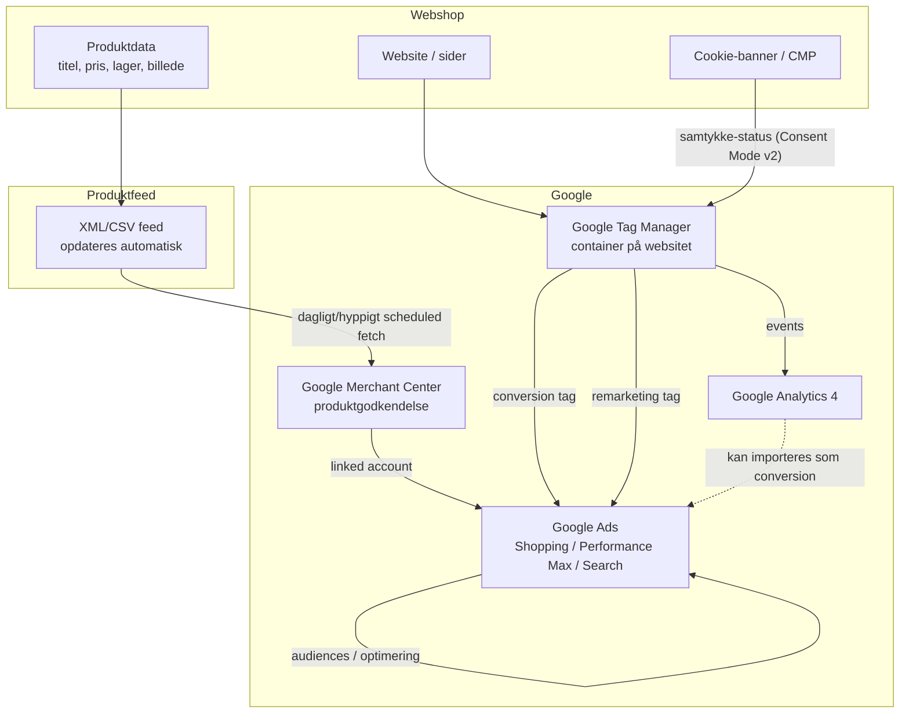

# Google Ads – struktur og dataflow

**Webshop:** [naturlaboratoriet.dk](https://naturlaboratoriet.dk)

Overblik over hvordan webshop, produktfeed, Google Merchant Center, Google Tag
Manager, cookie-samtykke og Google Ads hænger sammen.

## Overblik (diagram)

## Komponenterne

### 1. Webshop
Kilden til al data. Produktinfo (titel, beskrivelse, pris, lagerstatus,
billede, GTIN/EAN osv.) ligger her og skal holdes opdateret — det er det
Merchant Center senere henter.

### 2. Produktfeed
Et XML- eller CSV-dokument som webshoppen (eller et feed-værktøj) genererer
automatisk, i det format Google kræver. Opdateres typisk dagligt eller
hyppigere, så priser/lager altid er korrekte. Dette repo (`feeds-nl`) er
formentlig stedet feed-logikken/konfigurationen for det hollandske marked
ligger.

### 3. Google Merchant Center (GMC)
Henter produktfeed'en på et fast interval, **godkender eller afviser**
produkter (ud fra Googles regler — manglende GTIN, forkert pris-format,
billedkrav osv.), og stiller de godkendte produkter til rådighed for Google
Ads.

- **Linkes** til en Google Ads-konto (konto-til-konto link, ikke en tag).
- Fejl/advarsler på produkter tjekkes her — ikke i Google Ads.

### 4. Google Tag Manager (GTM)
Et "container"-script der lægges på hele websitet. I stedet for at indsætte
Google Ads/Analytics-kode direkte i sitet, styres alle tags (målinger,
remarketing, konverteringssporing) centralt fra GTM's interface.

Typiske tags i en webshop-opsætning:
- **Google Ads conversion tracking** — måler køb/leads der kommer fra annoncer
- **Google Ads remarketing tag** — bygger lister af besøgende til retargeting
- **GA4-konfiguration** — generel adfærdsmåling (sidevisninger, add-to-cart, køb)
- **Enhanced conversions** — sender hashed kundedata (email/telefon) med for
  bedre match-rate

### 5. Cookie-samtykke (CMP) + Consent Mode v2
Et cookie-banner (Cookiebot, OneTrust, CookieYes, Complianz, e.l.) spørger
besøgende om samtykke, **før** marketing-/statistik-cookies må sættes — et
krav under GDPR, og dermed relevant for et `.nl`-marked.

- CMP'en sender samtykke-status til GTM via **Google Consent Mode v2**
  (signalerne `ad_storage`, `ad_user_data`, `ad_personalization`,
  `analytics_storage`).
- GTM bruger de signaler til at afgøre **om** og **hvordan** tags fyrer:
  - Samtykke givet → fulde tags (cookies sættes, fuld sporing)
  - Samtykke afvist → Google kan stadig modtage **cookieless pings** (hvis
    Consent Mode er korrekt opsat), som bruges til modellering — men ingen
    cookies sættes, og ingen personlige data gemmes.
- **Uden korrekt Consent Mode-opsætning** mister Google Ads konverteringsdata
  fra besøgende der afviser cookies, hvilket forringer budoptimering
  (særligt i Performance Max, som er meget data-afhængig).

### 6. Google Ads
Her bygges kampagnerne:
- **Shopping / Performance Max**: bruger produkterne fra Merchant Center
  direkte — ingen separat annoncetekst/billede, Google sammensætter ud fra
  feed-data.
- **Search/Display/Video**: bruger konverteringsdata fra GTM-tagget til at
  optimere bud, og remarketing-lister til target.

## Dataflow, trin for trin

1. Produktdata opdateres i webshoppen.
2. Feed-filen regenereres (automatisk, scheduled).
3. Merchant Center henter feed'en, validerer og godkender produkter.
4. Godkendte produkter er tilgængelige for Google Ads via kontolinket.
5. Besøgende lander på sitet → cookie-banner viser sig → samtykke
   registreres.
6. GTM modtager samtykke-status → fyrer tags i overensstemmelse hermed.
7. Events (sidevisning, add-to-cart, køb) sendes til GA4 og Google Ads.
8. Google Ads bruger konverteringsdata + produktdata til at optimere bud og
   vise annoncer (Shopping/PMax) til relevante brugere.
9. Remarketing-lister (fra GTM-tagget) bruges til at vise annoncer til
   tidligere besøgende.

## Anbefalet opsætningsrækkefølge

Hvis noget af dette mangler, er dette en fornuftig rækkefølge at bygge i:

1. **Produktfeed** sat op og valideret (ingen fejl i formatet).
2. **Merchant Center**-konto oprettet, feed tilknyttet, produkter godkendt.
3. **CMP/cookie-banner** installeret på sitet.
4. **GTM-container** installeret på alle sider.
5. **Consent Mode v2** konfigureret i GTM, forbundet til CMP'ens
   samtykke-signaler (de fleste CMP'er har en built-in GTM-integration).
6. **GA4-tag** sat op i GTM (konfigurationstag + events).
7. **Google Ads conversion- og remarketing-tags** sat op i GTM.
8. **Merchant Center linket til Google Ads**-kontoen.
9. Kampagner oprettet (Shopping/Performance Max) i Google Ads.
10. Test: brug GTM's **Preview-mode** + Google Tag Assistant til at verificere
    at tags fyrer korrekt, både med og uden samtykke givet.

## Vigtige begreber

| Begreb | Betydning |
|---|---|
| **Feed** | Den fil Merchant Center henter produktdata fra |
| **Linked account** | Forbindelsen mellem Merchant Center og Google Ads (ikke en tag) |
| **Container (GTM)** | Samlingen af alle tags/triggers for ét website |
| **Consent Mode v2** | Googles standard for at signalere samtykke-status til Google-tags |
| **Enhanced conversions** | Ekstra matchdata (hashed email/telefon) for bedre konverteringssporing |
| **Performance Max (PMax)** | Kampagnetype der bruger produktfeed + AI til automatisk at vise annoncer på tværs af Googles flader |

## Åbne spørgsmål / ting at bekræfte

> Denne fil er lavet generisk, da jeg ikke kender jeres konkrete opsætning.
> Tjek/udfyld følgende for at gøre den præcis for jer. Skærmbilleder af
> GTM-containeret, cookie-bannerets indstillinger og Merchant Center er en
> hurtig måde at få dem udfyldt på.

- [x] **Platform:** ser ud til at være **WooCommerce på WordPress** (ud fra
      URL-mønstre som `/product/`, `/product-category/`,
      `wp-content/uploads/...`). *Ikke 100% bekræftet — scripts i `<head>`
      kunne ikke tjekkes, da hosting (Simply.com) blokerede automatisk
      hentning af siden. Bekræft gerne selv.*
- [ ] Genereres feed'en af en WooCommerce-plugin (fx "Product Feed Pro",
      "WooCommerce Google Feed Manager" e.l.), eller af et separat
      feed-værktøj (fx dette repo)?
- [ ] Er der allerede et GTM-container-ID installeret (`GTM-XXXXXXX`)? Tjek
      sidens kildekode (`Ctrl+U` i browseren) eller GTM's "Preview"-funktion.
- [ ] Hvilken CMP/cookie-plugin bruges (for WooCommerce typisk Complianz,
      CookieYes, Cookiebot, eller Borlabs)?
- [ ] Er Consent Mode v2 allerede sat op i GTM, eller mangler det?
- [ ] Bruges Enhanced Conversions / server-side tagging?
- [ ] Hvor mange Merchant Center/Google Ads-konti er der (fx ét per land/marked)?
